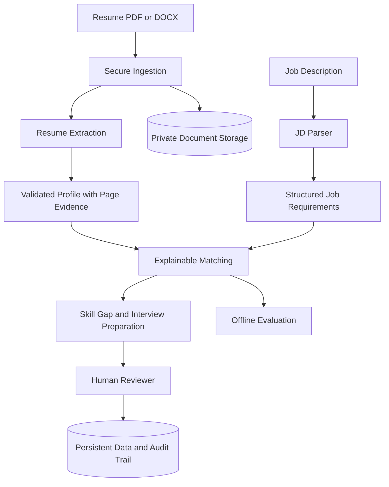

# AI Hiring Copilot

An early-stage, recruiter-assistance application for parsing resumes, understanding job descriptions, and producing explainable, evidence-backed candidate-to-role insights. The system is intended to support human reviewers; it must not make autonomous hiring or rejection decisions.

> **Project status:** Backend ingestion prototype. The repository currently contains a FastAPI backend and PDF text extraction. The frontend directory is empty. Resume-to-job matching, structured LLM extraction, persistence, reviewer workflows, evaluation, and deployment are roadmap items unless separately verified in code.

## Current verified baseline

| Capability | Status | Evidence |
|---|---|---|
| Local Python environment | Set up | Windows, Python 3.12.10, `uv` |
| FastAPI application startup | Tested | Uvicorn startup completed locally |
| Swagger / OpenAPI | Tested | `/docs` and `/openapi.json` opened locally |
| PDF upload endpoint | Tested | `POST /api/resume/upload` returned HTTP 200 |
| PDF text extraction | Tested | Sample PDF extracted; response included page and character counts |
| Batch 1 automated tests | Tested | User-reported Windows run: `14 passed in 1.31s` on 2026-11-01 |
| Frontend | Missing | `frontend/` has no application files |
| Database persistence | Not implemented / not verified | No verified persistence workflow yet |
| Groq structured extraction | Not implemented / not verified | Dependency presence is not proof of provider integration |
| JD parsing and resume-JD matching | Planned | Not verified in the current code |
| Human review, audit trail, and deployment | Planned | Not verified |

Statuses describe the evidence available for this repository snapshot; update this table after each verified milestone.

## Repository layout

```text
ai_hiring_copilot/
├── README.md
├── .gitignore
├── requirements.txt
├── backend/
│   ├── app.py
│   ├── .env.example
│   ├── requirements.txt
│   ├── requirements-dev.txt
│   ├── routes/
│   │   └── resume.py
│   ├── services/
│   │   └── pdf_extractor.py
│   └── tests/
│       ├── conftest.py
│       └── test_pdf_extractor.py
└── frontend/                 # currently empty; frontend is not implemented
```

## Local setup — Windows CMD

The following commands assume the repository is located at `E:\ai_hiring_copilot-main`. Adjust the path if yours differs.

```cmd
cd /d E:\ai_hiring_copilot-main
uv venv --python 3.12 .venv
.venv\Scripts\activate.bat
uv pip install -r backend\requirements.txt
uv pip install -r backend\requirements-dev.txt
```

Run the API from the repository root:

```cmd
python -m uvicorn app:app --app-dir backend --reload
```

Open the interactive API documentation:

- http://127.0.0.1:8000/docs
- http://127.0.0.1:8000/openapi.json

Stop the local server with `CTRL+C`.

## Tests

With the virtual environment activated, run:

```cmd
python -m pytest backend\tests -q
```

The latest reported local Batch 1 test result is `14 passed in 1.31s` (2026-11-01). Re-run the suite after pulling or changing code; this historical result is not a guarantee that future changes pass.

## Current API

### `POST /api/resume/upload`

Accepts a PDF as `multipart/form-data` using the `file` field. The current tested response returns processing metadata such as status, byte size, page count, and extracted character count. It does not need to return the full resume text to the caller.

Use only synthetic or explicitly authorized, anonymized resumes in development and tests. Do not commit resumes, extracted personal data, API keys, `.env` files, virtual environments, or generated uploads to Git.

## Target product capabilities

The intended product is a resume intelligence and job-matching assistant with the following independently testable capabilities:

1. **Secure document ingestion:** PDF/DOCX validation, file/page limits, safe storage, checksum, deletion, and tenant-scoped access.
2. **Structured resume extraction:** skills, work history, projects, education, and certifications in validated schemas, with page/quote evidence and explicit unknown values.
3. **Job description parsing:** required/preferred skills, responsibilities, experience, education, location, and employment details with source evidence.
4. **Explainable matching:** transparent skill normalization and lexical/semantic matching; show matched, partially matched, missing-evidence, and unverified requirements.
5. **Skill-gap analysis:** distinguish missing evidence from proof that a person lacks a skill; produce learning objectives and assessments.
6. **Interview preparation:** role- and evidence-linked questions with difficulty levels and evaluation rubrics.
7. **Personalized learning plans:** prerequisites, learning resources, practical exercises, projects, and measurable outcomes.
8. **Human review:** reviewer notes, overrides, and audit history. No automatic hiring or rejection.
9. **Evaluation and operations:** deterministic offline tests, labeled evaluation sets, security tests, CI, observability, deployment, and rollback documentation.

## Proposed architecture direction

Start with a modular FastAPI application rather than microservices. Add PostgreSQL for persistent application data, SQLAlchemy and Alembic for data access and migrations, and a storage adapter for original documents. Use provider interfaces for LLM and embedding services, with deterministic fakes for normal tests. Add lexical and dense retrieval only when the matching requirements and evaluation set justify them. Introduce LangGraph for workflows that genuinely need explicit state, validation, bounded retries, or controlled recovery.



This diagram is a target architecture, not a claim that all components are already implemented.

## Responsible-use and privacy principles

- The product assists human reviewers; it does not automatically hire or reject candidates.
- Do not score, filter, or rank using protected attributes or inferred proxies.
- Keep protected attributes out of model inputs and matching features.
- Treat resume files, extracted text, and job descriptions as untrusted inputs.
- Validate LLM outputs against strict schemas and verify evidence quotes against source pages.
- Do not log raw resume text, candidate names, emails, phone numbers, or secrets.
- Enforce tenant/actor authorization in backend data access, not only in the UI.
- Define retention and deletion behavior for both stored files and derived data.
- Use synthetic or explicitly authorized/anonymized data in tests and demos.
- Do not claim that a small synthetic evaluation proves fairness or hiring validity.

## Planned engineering phases

| Phase | Deliverable | Status |
|---|---|---|
| 1 | Secure ingestion, page-aware extraction, storage, metadata, ownership, deletion, and tests | In progress |
| 2 | Structured resume extraction with evidence and deterministic fake provider | Planned |
| 3 | Evidence-backed job description parsing | Planned |
| 4 | Explainable resume-JD matching and skill taxonomy | Planned |
| 5 | Skill-gap analysis, interview preparation, and learning roadmap | Planned |
| 6 | Human review, audit, evaluation, security, CI, and deployment hardening | Planned |
| 7 | Frontend and end-to-end product integration | Planned; frontend directory currently empty |

## Configuration and secrets

`backend/.env.example` is a template location. Add only configuration variables that are actually consumed by the application. Keep real secrets in a local `.env` file or a secret manager; never commit them. Do not add a paid provider as a requirement for the offline test suite.

## Limitations

- Current verified functionality is limited to local FastAPI startup and PDF upload/text extraction.
- No verified database-backed resume lifecycle is available yet.
- No verified JD parser, matching engine, candidate ranking, skill-gap engine, or learning-resource retrieval is available yet.
- The frontend is not implemented.
- No production deployment, load test, or real-world hiring validity has been established.

## License

No license is declared yet. Add one only after confirming the intended license and checking the usage rights of dependencies, models, and datasets.
